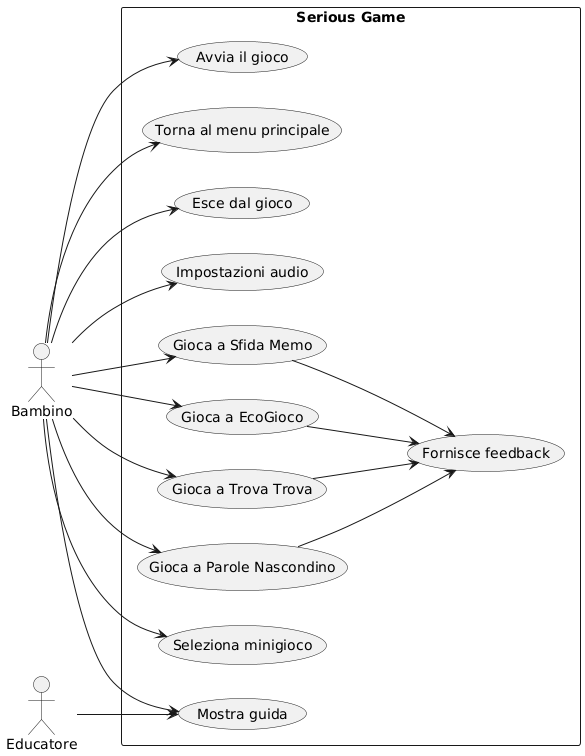
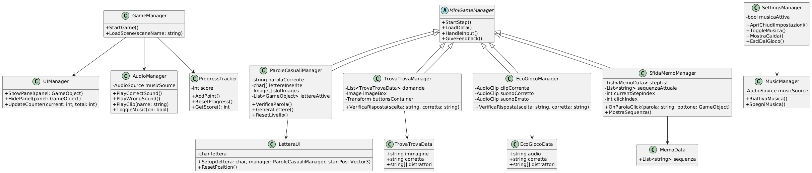

# Parolandia

**Serious game per il potenziamento delle abilità linguistiche nei bambini con DSA (dislessia)**

Progetto di tesi della Laurea Triennale in Ingegneria Informatica, Università degli Studi di Bergamo (A.A. 2024/2025), sviluppato da Andrea Milani con la supervisione del gruppo di ricerca [se4med](https://github.com/se4med).

> *English summary: Parolandia is a desktop serious game built with Unity and C# that helps children with dyslexia practise reading, listening, visual attention and short-term memory through four mini-games with three difficulty levels each. The project followed a full software engineering process: requirements (MoSCoW), project plan, UML modelling, automated in-scene tests and builds for Windows and macOS.*

---

## Il progetto

I bambini con Disturbi Specifici dell'Apprendimento spesso vivono la lettura con fatica e ansia da prestazione. Parolandia trasforma l'esercizio in gioco: attività brevi e progressive, supporto audio, feedback sempre positivo e un'interfaccia semplice, colorata e accessibile.

Il gioco contiene **4 minigiochi**, ognuno con **3 livelli di difficoltà crescente** da 5 round ciascuno:

| Minigioco | Abilità allenata | Come funziona |
| --- | --- | --- |
| **Parole Nascondino** | Lettura e composizione | Il bambino ricompone una parola scegliendo le lettere nell'ordine giusto (4, 5 e 6 lettere nei tre livelli) |
| **Trova Trova** | Riconoscimento visivo | Viene mostrata un'immagine e bisogna scegliere la parola corretta tra parole simili (es. *casa* / *cassa*) |
| **EcoGioco** | Ascolto e comprensione | Il bambino ascolta una parola pronunciata e la riconosce tra le alternative scritte |
| **Sfida Memo** | Memoria a breve termine | Bisogna ricordare e riprodurre una sequenza di immagini |

## Tecnologie

- **Unity** (motore di gioco) e **C#** (logica di gioco)
- **JSON** per i contenuti dei livelli, così parole ed esercizi si modificano senza toccare il codice
- **Git e GitHub** per il versionamento
- **PlantUML** e **StarUML** per la modellazione, **LaTeX/Overleaf** per la documentazione
- **Audacity** per le risorse audio
- Build per **Windows** e **macOS**

## Ingegneria del software

Il progetto ha seguito l'intero ciclo di sviluppo, gestito individualmente:

1. **Requisiti**: specifica dei requisiti funzionali, non funzionali e di qualità, con priorità secondo il metodo **MoSCoW**
2. **Pianificazione**: project plan, analisi dei rischi e sviluppo incrementale (un minigioco alla volta)
3. **Progettazione**: architettura modulare ispirata al pattern **MVC**, con scene indipendenti e componenti riutilizzabili (GameManager, UIManager, AudioManager, SettingsManager)
4. **Modellazione UML**: casi d'uso, classi, componenti, pacchetti, sequenza, attività, comunicazione e macchina a stati
5. **Testing**: script **TestHelper** in ogni scena che verificano automaticamente la configurazione, più test manuali su flusso di gioco, audio e navigazione, eseguiti sulle build per macOS e Windows

<p align="center">
  
  
</p>

## Struttura del repository

```
CODE/
├── SCRIPTS/            Script C# divisi per scena
│   ├── MainMenu/       Menù principale, impostazioni, musica, guida
│   ├── SelectGames/    Selezione dei minigiochi e caricamento scene
│   ├── ParoleNascondino/
│   ├── TrovaTrova/
│   ├── EcoGioco/
│   └── SfidaMemo/
└── RESOURCES/          Livelli in JSON, immagini e audio delle parole
DOCUMENTI/
├── DOCU_GAME/          Specifica dei requisiti
├── OVERLEAF/           Project plan e tesi completa (PDF)
└── UML/                Diagrammi UML
```

## Documentazione

- [Tesi completa](DOCUMENTI/OVERLEAF/TESI.pdf)
- [Specifica dei requisiti](DOCUMENTI/DOCU_GAME/Requisiti_Serious_Game_DSA.pdf)
- [Project plan](DOCUMENTI/OVERLEAF/PROJECT_PLAN.pdf)

## Sviluppi futuri

- Nuovi minigiochi su grammatica e comprensione del testo
- Difficoltà adattiva in base alle risposte del bambino
- Versione per tablet

---

**Autore:** Andrea Milani · [LinkedIn](https://www.linkedin.com/in/andrea-milani-1322ab43b)
**Relatori:** Prof. Angelo Michele Gargantini, Prof.ssa Silvia Bonfanti, Università degli Studi di Bergamo
